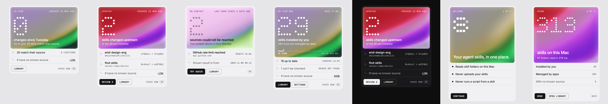

# Skillori

> Know your skills. See what changed.

Skillori is a small macOS menu bar app that shows which AI agent skills are on your Mac, no matter which agent they belong to or how they were installed. It tells you where each skill came from, and whether its source has changed since you installed it.



## What it does

- **Finds your skills.** Reads the skill folders of Claude Code, Cursor, Codex, Gemini CLI, Antigravity, GitHub Copilot, OpenCode, Amp, Kiro, Factory Droid, Devin Desktop and goose, including the shared `~/.agents/skills` folder and plugin caches. The same skill linked into five agents shows up once.
- **Knows where they came from.** Reads the lockfile written by `npx skills` and the plugin metadata of Claude Code, Cursor and Codex. Skills with no known source can be linked to a GitHub repository by hand.
- **Tells you what changed.** When you turn it on, it asks GitHub whether a skill's source folder has changed, by comparing git tree hashes. No account, no token.
- **Stays out of the way.** Lives in the menu bar. Skills you wrote yourself are listed first; the hundreds managed by plugins are grouped under the app that manages them.

## Principles

- Skill content is treated as untrusted data. Skillori never runs a script from a skill, neither while reading nor while comparing.
- Nothing is uploaded. The only network request is the optional upstream check, and it carries the repository name and nothing else.
- Skillori doesn't write to your skill folders. An update only happens when you press **Update**, and then it's `npx skills update` that writes the files.

## Status

Early. Version 0.0.1, built and used by one person. Reading the inventory works well; update checks work for skills installed with `npx skills` and for skills you link by hand. There is no download yet, so for now you build it yourself. See the [backlog](docs/backlog.md) (in Swedish) for what's next.

## Building

Requirements: macOS 15 or later, Xcode with the Swift 6 toolchain (developed with Xcode 27), and [XcodeGen](https://github.com/yonaskolb/XcodeGen).

```bash
brew install xcodegen
xcodebuild -downloadComponent MetalToolchain   # once; the build compiles a Metal shader
xcodegen generate
open Skillori.xcodeproj
```

Or from the command line:

```bash
xcodebuild -project Skillori.xcodeproj -scheme Skillori -configuration Release -derivedDataPath build/DerivedData build
open build/DerivedData/Build/Products/Release/Skillori.app
```

The `.xcodeproj` is generated from [`project.yml`](project.yml) and is not committed. Run `xcodegen generate` again after adding or removing files.

### Signing

Out of the box the app gets an ad-hoc signature, so it builds on any Mac without an Apple developer account. To sign with your own Developer ID, copy [`Config/Signing.local.xcconfig.example`](Config/Signing.local.xcconfig.example) to `Config/Signing.local.xcconfig` and fill in your team ID. That file is ignored by git. [`scripts/notarize.sh`](scripts/notarize.sh) builds, signs, notarizes and staples a release; its header lists what it needs.

### Tests

```bash
swift test --package-path Packages/SkilloriCore
```

Tests build their fixtures in temporary folders and never touch real installations.

## Project layout

| Path | What's there |
| --- | --- |
| `App/Skillori/` | The app: menu bar panel, library window, detail view, settings |
| `Packages/SkilloriCore/` | Discovery, adapter rules per agent, `SKILL.md` parsing, git tree hashing, lockfile reading, upstream checks. No UI. |
| `Packages/SkilloriCore/Sources/SkilloriProbe/` | `skillori-probe`, a command line tool that prints the inventory for the current user |
| `Packages/SkilloriUI/` | Design tokens, typography, components and the `LightField` Metal shader |
| `docs/` | Product brief, research, architecture decisions and design history. See [docs/README.md](docs/README.md). |

The docs are written in Swedish, the code and the app in English.

## Contributing

Forks are welcome, and so are issues and pull requests. See [CONTRIBUTING.md](CONTRIBUTING.md). To report a security problem, see [SECURITY.md](SECURITY.md).

## License

The code is released under the [MIT License](LICENSE).

The license covers the code, not the name or the brand. "Skillori" and the Skillori mark are not licensed for use in forks: if you distribute your own version, give it its own name, icon and bundle identifier.

Some files come from others and keep their own terms:

- Inter and Geist Mono are under the SIL Open Font License 1.1 (see [`Packages/SkilloriUI/Sources/SkilloriUI/Resources/Fonts/`](Packages/SkilloriUI/Sources/SkilloriUI/Resources/Fonts/)).
- The agent logos in [`App/Skillori/AgentLogos/`](App/Skillori/AgentLogos/) are trademarks of their owners and are used only to identify each agent.
